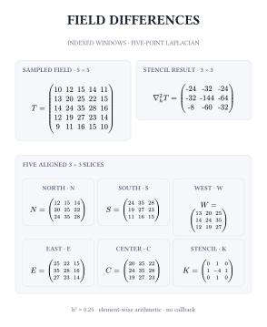
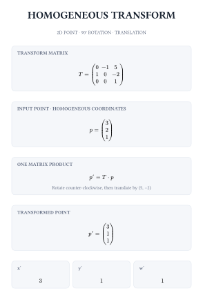
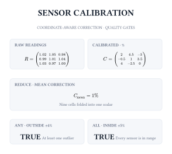
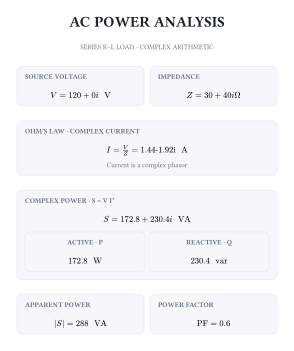

# Kalt

**Evaluate real, complex, vector, and matrix expressions directly in Typst.**

Kalt evaluates Typst math with indexing, slicing, element-wise tensor arithmetic, matrix products, complex numbers, and collection helpers. The examples below are complete calculations: executable Typst source on the left, its rendered result on the right.

## 01 · Slice and combine a field

A five-point discrete Laplacian over a sampled 5×5 field. Five aligned 3×3 slices are evaluated, then combined with Kalt’s element-wise matrix arithmetic. There is no per-cell callback: compatible matrix operators already work cell by cell.

<table>
  <thead>
    <tr><th align="left" width="52%">Typst source</th><th align="left" width="48%">Rendered result</th></tr>
  </thead>
  <tbody>
    <tr>
      <td valign="top">
        <pre><code class="language-typst">#import "@preview/kalt:0.1.1": comp

#let field = $mat(
  10, 12, 15, 14, 11;
  13, 20, 25, 22, 15;
  14, 24, 35, 28, 16;
  12, 19, 27, 23, 14;
  9, 11, 16, 15, 10
)$

#let north = comp($#field [0:3, 1:4]$)
#let south = comp($#field [2:5, 1:4]$)
#let west = comp($#field [1:4, 0:3]$)
#let east = comp($#field [1:4, 2:5]$)
#let middle = comp($#field [1:4, 1:4]$)

#let laplacian = comp($4 * (
  #north + #south + #west + #east
  - 4 * #middle
)$)

$ nabla_h^2 T = #laplacian $</code></pre>
      </td>
      <td valign="top">
        
      </td>
    </tr>
  </tbody>
</table>

## 02 · Transform a point in homogeneous coordinates

A 3×3 transform rotates a 2D point by 90° counter-clockwise and translates it by (5, −2). The dot operator performs matrix multiplication; slices extract the transformed coordinates.

<table>
  <thead>
    <tr><th align="left" width="52%">Typst source</th><th align="left" width="48%">Rendered result</th></tr>
  </thead>
  <tbody>
    <tr>
      <td valign="top">
        <pre><code class="language-typst">#import "@preview/kalt:0.1.1": comp

#let transform = $mat(
  0, -1, 5;
  1, 0, -2;
  0, 0, 1
)$
#let point = $vec(3, 2, 1)$
#let moved = comp($#transform dot #point$)

#let x = comp($#moved [0, 0]$)
#let y = comp($#moved [1, 0]$)
#let homogeneous = comp($#moved [2, 0]$)

$ p' = #moved $
$ (x', y', w') = (#x, #y, #homogeneous) $</code></pre>
      </td>
      <td valign="top">
        
      </td>
    </tr>
  </tbody>
</table>

## 03 · Calibrate a sensor array and gate its quality

The map callback applies a value correction and a coordinate-dependent offset. Reduce folds the corrected field into a mean; any and all check outlier and operating-range conditions.

<table>
  <thead>
    <tr><th align="left" width="52%">Typst source</th><th align="left" width="48%">Rendered result</th></tr>
  </thead>
  <tbody>
    <tr>
      <td valign="top">
        <pre><code class="language-typst">#import "@preview/kalt:0.1.1": all, any, comp, map, reduce

#let raw = $mat(
  1.02, 1.05, 0.98;
  0.99, 1.01, 1.04;
  1.03, 0.97, 1.00
)$

#let calibrated = map(
  (reading, x, y) =&gt; (reading - 1) * 100 - (x - y) * 0.5,
  raw,
)
#let total = reduce(
  (sum, value) =&gt; sum + comp(value),
  0,
  calibrated,
)
#let mean = total / 9
#let has_outlier = any(
  value =&gt; comp(value) &gt; 4 or comp(value) &lt; -4,
  calibrated,
)
#let all_in_range = all(
  value =&gt; comp(value) &gt;= -5 and comp(value) &lt;= 5,
  calibrated,
)

#let outlier_label = if has_outlier { "YES" } else { "NO" }
#let range_label = if all_in_range { "YES" } else { "NO" }

#align(center)[
  Mean correction: #mean %
  #linebreak()
  Outlier detected: #outlier_label
  #linebreak()
  All sensors in range: #range_label
]</code></pre>
      </td>
      <td valign="top">
        
      </td>
    </tr>
  </tbody>
</table>

## 04 · Compute complex power in an AC circuit

A series R–L load turns a real source voltage and complex impedance into a current phasor. Conjugation gives complex power; Re, Im, and abs extract active power, reactive power, and apparent magnitude.

<table>
  <thead>
    <tr><th align="left" width="52%">Typst source</th><th align="left" width="48%">Rendered result</th></tr>
  </thead>
  <tbody>
    <tr>
      <td valign="top">
        <pre><code class="language-typst">#import "@preview/kalt:0.1.1": comp

#let voltage = $120 + 0i$
#let impedance = $30 + 40i$
#let current = comp($#voltage / #impedance$)
#let current_conjugate = comp($#current^*$)
#let apparent = comp($#voltage * #current_conjugate$)

#let active = comp($Re(#apparent)$)
#let reactive = comp($Im(#apparent)$)
#let apparent_magnitude = comp($abs(#apparent)$)
#let power_factor = calc.round(active / apparent_magnitude, digits: 2)

$I = #current " A"$
$S = #apparent " VA"$
$P = #active " W"$
$Q = #reactive " var"$
$"PF" = #power_factor$</code></pre>
      </td>
      <td valign="top">
        
      </td>
    </tr>
  </tbody>
</table>

## Documentation

The [Typst operation reference](typst/README.md) covers expression evaluation, matrix and vector notation, indexing and slicing, element-wise arithmetic versus matrix products, callbacks and aggregation, complex functions, comparisons, and bitwise operators.

## Continue

- [Kalt on Typst Universe](https://typst.app/universe/package/kalt/)
- [Report a bug or request a feature](https://github.com/Uhrendoktor/kalt/issues)

Kalt is released under the [MIT License](LICENSE).
