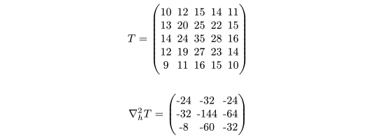

# Kalt

**Evaluate sliced matrix expressions directly in Typst.**

Kalt evaluates complex, vector, and matrix expressions written in Typst math. Its indexing, slicing, and element-wise matrix operations let you build a stencil directly from selected matrix regions—without writing a per-cell callback.

## First use: a 2D discrete Laplacian

Compute the five-point discrete Laplacian of a sampled 5×5 field at all nine interior cells. Each slice selects a 3×3 window. Kalt adds and subtracts these windows element by element, then `comp` evaluates the complete expression.

~~~typst
#import "@preview/kalt:0.1.1": comp

#let field = $mat(
  10, 12, 15, 14, 11;
  13, 20, 25, 22, 15;
  14, 24, 35, 28, 16;
  12, 19, 27, 23, 14;
  9, 11, 16, 15, 10
)$

#let laplacian = comp($(
  #field [0:3, 1:4]
  + #field [2:5, 1:4]
  + #field [1:4, 0:3]
  + #field [1:4, 2:5]
  - 4 * #field [1:4, 1:4]
) / 0.25$)

$ nabla_h^2 T = #laplacian $
~~~

The result is a 3×3 matrix of second-order spatial differences. Slice stop indices are exclusive, so all five windows have matching dimensions. Matrix `+`, `-`, and scalar multiplication act element-wise; no `map` call is needed.

## Documentation

The [Typst guide and operation reference](typst/README.md) explains matrix and vector notation, arithmetic, indexing and slicing, the collection helpers, complex functions, comparisons, and bitwise operators.

## Continue

- [Kalt on Typst Universe](https://typst.app/universe/package/kalt/)
- [Report a bug or request a feature](https://github.com/Uhrendoktor/kalt/issues)

Kalt is released under the [MIT License](LICENSE).
