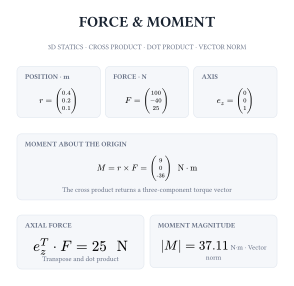

# Kalt

**Evaluate real, complex, vector, and matrix expressions directly in Typst.**

Kalt evaluates nested Typst math with scalars, complex numbers, vectors, matrices, indexing, and arithmetic. The four compact examples below show the source beside the result produced by Typst itself.

Each preview is one Typst document: the left pane reads and syntax-highlights the example file, while the right pane includes and renders that exact same file. The two sides cannot drift apart.

## Matrix indexing

Read one entry and one row from a small matrix.


## Matrix arithmetic

Compare element-wise addition with matrix multiplication.


## Vector products

Use a transpose and dot product for the scalar product, and the cross product for a new vector.



## Complex arithmetic

Divide a voltage by a complex impedance, then use conjugation to calculate complex power.


## Documentation

The [Typst operation reference](typst/README.md) describes the supported syntax and functions. The editable examples are in [`typst/docs/examples/`](typst/docs/examples/); the paired layout is defined once in [`paired-preview.typ`](typst/docs/paired-preview.typ).

## Build

```bash
cargo build --workspace
cargo build --release --target wasm32-unknown-unknown -p kalt_bindings
```

To regenerate the paired previews with Typst 0.15.1:

```bash
bash typst/docs/render-examples.sh
```

Kalt is released under the [MIT License](LICENSE).
