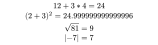
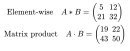
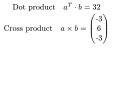
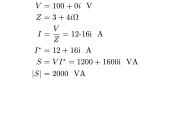
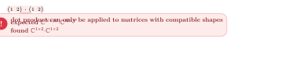

# Kalt

**Calculate directly inside your Typst equations.**

Kalt adds a calculator to Typst math. Write an equation as usual and put `#comp(...)` around the part you want calculated. The answer appears right inside your document. The examples below show what to write and what Typst renders.

## Everyday calculations

Use familiar math notation for sums, powers, roots, and functions.

````typst
#import "@preview/kalt:0.1.1": comp

$ 12 + 3 * 4 = #comp($12 + 3 * 4$) $
$ (2 + 3)^2 = #comp($(2 + 3)^2$) $
$ sqrt(81) = #comp($sqrt(81)$) $
$ log_2(8) = #comp($log_2(8)$) $
````




## Work with matrices

Add matrices cell by cell or calculate their matrix product.

````typst
#import "@preview/kalt:0.1.1": comp

#let a = $mat(1, 2; 3, 4)$
#let b = $mat(5, 6; 7, 8)$

$ "Element-wise" quad A * B = #comp($#a * #b$) $
$ "Matrix product" quad A dot B = #comp($#a dot #b$) $
````




## Work with vectors

Calculate dot and cross products with familiar vector notation.

````typst
#import "@preview/kalt:0.1.1": comp

#let a = $vec(1, 2, 3)$
#let b = $vec(4, 5, 6)$

$ "Dot product" quad a^T dot b = #comp($#a^T dot #b$) $
$ "Cross product" quad a times b = #comp($#a times #b$) $
````




## Use complex numbers

Complex numbers work in the same way as ordinary numbers. This example calculates current and power from voltage and impedance.

````typst
#import "@preview/kalt:0.1.1": comp

#let voltage = $100 + 0i$
#let impedance = $3 + 4i$

$ V &= #voltage " V" \
  Z &= #impedance Ω \
  I &= V / Z = #comp($#voltage / #impedance$) " A" \
  I^* &= #comp($(#voltage / #impedance)^*$) " A" \
  S &= V I^* = #comp($#voltage * (#voltage / #impedance)^*$) " VA" \
  abs(S) &= #comp($abs(#voltage * (#voltage / #impedance)^*)$) " VA" $
````




## When a calculation cannot be completed

Kalt does not silently guess when an expression cannot be calculated. Typst shows an error at the expression, together with a message that helps explain what went wrong.

For example, these two matrices do not fit together for this multiplication:

````typ
#import "@preview/kalt:0.1.1": comp

#comp($mat(1, 2) dot mat(1, 2)$)
````

The red highlight marks the part that caused the problem. The note above it shows what Kalt expected and what it found, giving you a useful clue about what to change.



## Documentation

The [Typst operation reference](typst/README.md) covers additional mathematical functions, matrices, vectors, and collection helpers. The source files shown here are in [`typst/docs/examples/`](typst/docs/examples/).

## Build

````bash
cargo build --workspace
cargo build --release --target wasm32-unknown-unknown -p kalt_bindings
````

Regenerate the titleless SVGs directly from those Typst files with Typst 0.15.1:

````bash
bash typst/docs/render-examples.sh
````

Kalt is released under the [MIT License](LICENSE).
