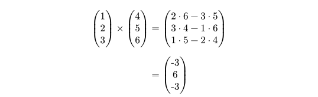
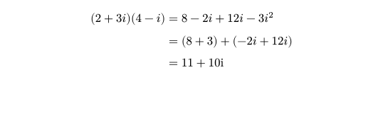
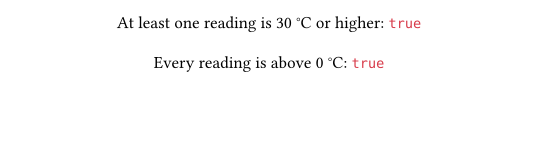

**Evaluate the mathematics in your Typst document.**

Kalt lets you evaluate the expressions you already write in Typst. Wrap an expression in <code>comp(...)</code> and place its computed value directly in a derivation. The examples below follow the mathematics from its inputs through the intermediate steps to the evaluated result.

## A first calculation

Start with an ordinary expression in Typst math. Kalt evaluates the same expression in place, so the derivation and its numerical result stay together.

~~~typst
#import "@preview/kalt:0.1.1": comp

$ sqrt(3^2 + 4^2) &= comp(sqrt(3^2 + 4^2)) \\
  e^(i pi)         &= comp(e^(i pi)) $
~~~

The first expression evaluates to <code>5</code>; the second is Euler's identity and evaluates to <code>-1</code>. The result can also be used in Typst code—for example, to size a shape:

~~~typst
#let length = comp($sqrt(3^2 + 4^2)$)
#rect(width: length * 1cm, height: 3mm)
~~~

## Matrix multiplication, one entry at a time

Consider the matrices

The entry in row $i$, column $j$ of the product is the dot product of row $i$ of the first matrix and column $j$ of the second. Showing all four entries makes the calculation explicit:

Kalt evaluates the product from the same native Typst matrix notation:

~~~typst
#import "@preview/kalt:0.1.1": comp

$ mat(1, 2; 3, 4) dot mat(5, 6; 7, 8)
  &= comp(mat(1, 2; 3, 4) dot mat(5, 6; 7, 8)) $
~~~

The output is the matrix whose entries were calculated above. The important distinction is that <code>dot</code> performs matrix multiplication; ordinary <code>*</code> between compatible matrices is element-wise multiplication.

## Vector products

Kalt's <code>vec(...)</code> notation represents a column vector. For the inner (dot) product, transpose the first vector so that it is a row vector:

$$
a^T b = 1\cdot4 + 2\cdot5 + 3\cdot6 = 32.
$$

The rendered derivation shows the component products, their sum, and Kalt's evaluated result:

~~~typst
#import "@preview/kalt:0.1.1": comp

$ vec(1, 2, 3)^T dot vec(4, 5, 6)
  &= comp(vec(1, 2, 3)^T dot vec(4, 5, 6)) $
~~~

The cross product uses the signed two-by-two minors of the components:

$$
a\times b =
(2\cdot6-3\cdot5,\;3\cdot4-1\cdot6,\;1\cdot5-2\cdot4).
$$

Kalt evaluates the expression directly to the vector shown in the final line:

~~~typst
#import "@preview/kalt:0.1.1": comp

$ vec(1, 2, 3) × vec(4, 5, 6)
  &= comp(vec(1, 2, 3) × vec(4, 5, 6)) $
~~~

## Complex multiplication

Complex expressions use the same notation as Typst math. Expand by distributivity, replace $i^2$ with $-1$, then collect the real and imaginary terms:

$$
\begin{aligned}
(2+3i)(4-i)
  &= 8-2i+12i-3i^2\\
  &= (8+3)+(-2i+12i)\\
  &= 11+10i.
\end{aligned}
$$

The final line below is produced by Kalt evaluating the original expression:

~~~typst
#import "@preview/kalt:0.1.1": comp

$ (2 + 3i)(4 - i) &= comp((2 + 3i)(4 - i)) $
~~~

The same approach works with conjugation, real and imaginary parts, roots, logarithms, and trigonometric or hyperbolic functions. For example:

~~~typst
$ (2 + 3i)^* &= comp((2 + 3i)^*) \\
  Re(2 + 3i) &= comp(Re(2 + 3i)) \\
  Im(2 + 3i) &= comp(Im(2 + 3i)) $
~~~

## Transform and inspect matrix data

The collection helpers become useful when a calculation involves many related values. Here, a $2\times2$ matrix stores four temperature readings in Fahrenheit. <code>map</code> applies the conversion to every cell:

$$
C=(F-32)\frac{5}{9}.
$$

The first rendered stage shows the input matrix and the Celsius matrix returned by <code>map</code>:

~~~typst
#import "@preview/kalt:0.1.1": comp, map, reduce, any, all

#let fahrenheit = $mat(68, 77; 86, 95)$
#let celsius = map(
  (value, x, y) => (value - 32) * 5 / 9,
  fahrenheit,
)
~~~

Next, <code>reduce</code> folds the converted cells into a sum. Dividing by four gives the mean:

$$
\overline{C}=\frac{20+25+30+35}{4}=27.5\,^\circ\mathrm C.
$$

~~~typst
#let average = reduce(
  (sum, value) => sum + comp(value),
  0,
  celsius,
) / 4
~~~

Finally, <code>any</code> and <code>all</code> ask two different questions about the same data: whether at least one reading reaches $30\,^\circ\mathrm C$, and whether every reading is above freezing.

~~~typst
#let has-hot-reading = any(value => comp(value) >= 30, celsius)
#let all-above-freezing = all(value => comp(value) > 0, celsius)
~~~

<code>map</code> passes the numeric cell value followed by its zero-based column (<code>x</code>) and row (<code>y</code>) coordinates. The callbacks of <code>reduce</code>, <code>any</code>, and <code>all</code> receive the corresponding cell values; call <code>comp(value)</code> when the callback needs a numeric value rather than math content. Each helper can process multiple matrices or vectors in parallel. When the shapes differ, a missing corresponding cell is passed as <code>none</code>.

## Indexing and slicing

Matrix indices are zero-based. A single index selects an entry; a colon selects an entire row or column. For example, the entry in the second row and third column is selected with <code>[1, 2]</code>:

~~~typst
$ mat(10, 20, 30; 40, 50, 60)[1, 2]
  &= comp(mat(10, 20, 30; 40, 50, 60)[1, 2]) $
~~~

The same matrix can be sliced to select its first column:

~~~typst
$ mat(10, 20, 30; 40, 50, 60)[:, 0]
  &= comp(mat(10, 20, 30; 40, 50, 60)[:, 0]) $
~~~

Use <code>start:stop:step</code> for ranges. Omit a boundary to extend to the beginning or end; negative indices count from the end, and a negative step reverses the selected order.

## Comparisons and bitwise operations

Comparisons evaluate to numeric indicators: false is <code>0</code>, true is <code>1</code>. The bitwise operators work on integer values. The equations below keep each expression beside its evaluated result:

~~~typst
#import "@preview/kalt:0.1.1": comp

$ 3 > 2 &= comp(3 > 2) \\
  6 ∧ 3 &= comp(6 ∧ 3) \\
  6 ⊕ 3 &= comp(6 ⊕ 3) $
~~~

Here <code>∧</code> is bitwise AND, <code>∨</code> is bitwise OR, <code>⊕</code> is bitwise XOR, <code>¬</code> is Boolean NOT, <code>~</code> is integer bitwise NOT, and <code>⊙</code> is the Boolean matrix product.

## Function reference

Kalt supports the following mathematical functions:

| Category | Functions |
| --- | --- |
| Roots and combinations | <code>sqrt(x)</code>, <code>root(n, x)</code>, <code>binom(n, k)</code> |
| Trigonometry | <code>sin(x)</code>, <code>cos(x)</code>, <code>tan(x)</code> |
| Inverse trigonometry | <code>arcsin(x)</code>, <code>arccos(x)</code>, <code>arctan(x)</code> |
| Hyperbolic functions | <code>sinh(x)</code>, <code>cosh(x)</code>, <code>tanh(x)</code> |
| Inverse hyperbolic functions | <code>arcsinh(x)</code>, <code>arccosh(x)</code>, <code>arctanh(x)</code> |
| Logarithms | <code>ln(x)</code>, <code>log_a(x)</code> |
| Other functions | <code>abs(x)</code>, <code>floor(x)</code>, <code>ceil(x)</code> |

Factorials use <code>!</code>; powers use <code>^</code>. <code>abs(x)</code> gives the absolute value of a scalar, the length of a vector, or the determinant of a square matrix.

The matrix helpers are:

| Helper | Purpose |
| --- | --- |
| <code>map(fn, ..mats)</code> | Apply a callback to each corresponding cell and return a matrix. The callback also receives <code>x</code> and <code>y</code> coordinates. |
| <code>reduce(fn, initial, ..mats)</code> | Fold the cells into one result, starting with <code>initial</code>. |
| <code>any(fn, ..mats)</code> | Return <code>true</code> if the predicate matches at least one set of corresponding cells. |
| <code>all(fn, ..mats)</code> | Return <code>true</code> only if the predicate matches every set of corresponding cells. |
| <code>tensor-variant(value)</code> | Return <code>"scalar"</code> or <code>"matrix"</code> for mathematical content. |

## Reproducible figures

The equation figures in this guide are Typst output, not manually redrawn illustrations. Their source is [<code>typst/docs/figures.typ</code>](docs/figures.typ), and [<code>typst/docs/render-figures.sh</code>](docs/render-figures.sh) regenerates the SVG files with the same Typst version used by the test workflow.

For questions, bug reports, or ideas, visit the [Kalt issue tracker](https://github.com/Uhrendoktor/kalt/issues). The source is on [GitHub](https://github.com/Uhrendoktor/kalt).
