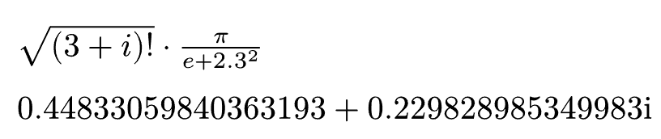
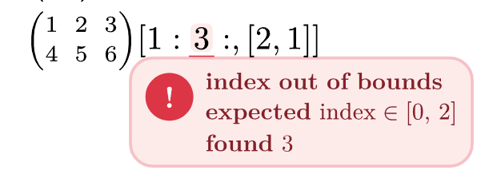
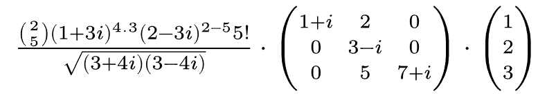
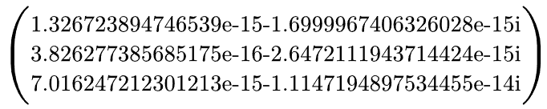

**Evaluate the mathematics in your Typst document.**

Kalt is a calculator for the notation you already write in Typst. Put `comp(...)` around an expression to evaluate it where it appears: in a derivation, beside a matrix product, or in a calculation that drives your document. Work with real and complex numbers, vectors, and matrices without leaving Typst or rewriting your formulas in another syntax.

## Start with an expression

Import `comp` from Typst Universe. Then write the expression as ordinary Typst math:

```typst
#import "@preview/kalt:0.1.1": comp

$ sqrt(3^2 + 4^2) &= comp(sqrt(3^2 + 4^2)) \\
  e^(i pi)         &= comp(e^(i pi)) $
```

For these examples, Kalt gives `5` and `-1`.

You can also use a calculated number in Typst code, for example to size an element in your document:

```typst
#let length = comp($sqrt(3^2 + 4^2)$)
#rect(width: length * 1cm, height: 3mm)
```

## Matrices and vectors

Use Typst's native `mat(...)` and `vec(...)` notation in the same way you would write them in an equation.

```typst
#import "@preview/kalt:0.1.1": comp

$ mat(1, 2; 3, 4) dot mat(5, 6; 7, 8)
  &= comp(mat(1, 2; 3, 4) dot mat(5, 6; 7, 8)) $

$ vec(1, 2, 3) dot vec(4, 5, 6)
  &= comp(vec(1, 2, 3) dot vec(4, 5, 6)) \\
  vec(1, 0, 0) × vec(0, 1, 0)
  &= comp(vec(1, 0, 0) × vec(0, 1, 0)) $
```

| Calculation | Result |
| --- | --- |
| Matrix product | `mat(19, 22; 43, 50)` |
| Vector dot product | `32` |
| Vector cross product | `vec(0, 0, 1)` |

Matrix addition, subtraction, multiplication, division, and modulo work element by element when dimensions match. Use `dot` for matrix multiplication and vector dot products, `×` for the cross product of three-dimensional vectors, and `^T` for a transpose. `abs(x)` gives the absolute value of a scalar, the length of a vector, or the determinant of a square matrix.

## Complex numbers and functions

Use `i` for the imaginary unit. Write conjugation with a superscript star, and use `Re` and `Im` for the real and imaginary parts:

```typst
$ (2 + 3i)^* &= comp((2 + 3i)^*) \\
  Re(2 + 3i) &= comp(Re(2 + 3i)) \\
  Im(2 + 3i) &= comp(Im(2 + 3i)) $
```

The results are `2 - 3i`, `2`, and `3`.

Kalt also supports these functions:

| Category | Functions |
| --- | --- |
| Roots and combinations | `sqrt(x)`, `root(n, x)`, `binom(n, k)` |
| Trigonometry | `sin(x)`, `cos(x)`, `tan(x)` |
| Inverse trigonometry | `arcsin(x)`, `arccos(x)`, `arctan(x)` |
| Hyperbolic functions | `sinh(x)`, `cosh(x)`, `tanh(x)` |
| Inverse hyperbolic functions | `arcsinh(x)`, `arccosh(x)`, `arctanh(x)` |
| Logarithms | `ln(x)`, `log_a(x)` |
| Other functions | `abs(x)`, `floor(x)`, `ceil(x)` |

Factorials use `!`; powers use `^`.



## Indexing and slicing

Matrix indices start at zero. Select a single entry, a full row or column, or a range:

```typst
$ mat(10, 20, 30; 40, 50, 60)[1, 2]
  &= comp(mat(10, 20, 30; 40, 50, 60)[1, 2]) \\
  mat(10, 20, 30; 40, 50, 60)[:, 0]
  &= comp(mat(10, 20, 30; 40, 50, 60)[:, 0]) $
```

The selected cell is `60`; the column slice is `mat(10; 40)`.

| Selection | Syntax |
| --- | --- |
| Single entry | `A[row, column]` |
| Whole row | `A[row, :]` |
| Whole column | `A[:, column]` |
| Range | `A[start:stop:step, :]` |
| Specific indices | `A[[0, 2], :]` |
| Reverse order | `A[::-1, ::-1]` |

Ranges use `start:stop:step`. Leave a part empty to use the beginning or end of that dimension. Negative indices count from the end; a negative step reverses the selected order.

An invalid index or slice is reported at the expression:



## Comparisons and Boolean operations

Comparisons evaluate to numeric indicators: false is `0`, true is `1`.

```typst
$ 3 > 2 &= comp(3 > 2) \\
  6 ∧ 3 &= comp(6 ∧ 3) \\
  6 ⊕ 3 &= comp(6 ⊕ 3) $
```

| Expression | Result |
| --- | --- |
| `3 > 2` | `1` |
| `6 ∧ 3` | `2` |
| `6 ⊕ 3` | `5` |

You can also pass Typst values directly to `comp`:

```typst
#comp(true)
#comp(12)
#comp(decimal("3.14159"))
#comp("2 + 3 * 4")
```

| Input | Result |
| --- | --- |
| `true` | `1.0` |
| `12` | `12.0` |
| `decimal("3.14159")` | `3.14159` |
| `"2 + 3 * 4"` | `14.0` |

The logical and bitwise operators are:

| Notation | Meaning |
| --- | --- |
| `∧` | Bitwise AND. |
| `∨` | Bitwise OR. |
| `⊕` | Bitwise XOR. |
| `¬` | Boolean NOT; flips `0` and `1`. |
| `~` | Bitwise NOT for integers. |
| `⊙` | Boolean matrix product. |

## Work with matrix data

The helper functions let you transform a matrix, combine its values, and ask questions about its entries. This example starts with four temperature readings in Fahrenheit, converts each one to Celsius, then calculates the average and checks the readings.

```typst
#import "@preview/kalt:0.1.1": comp, map, reduce, any, all

#let fahrenheit = $mat(68, 77; 86, 95)$
#let celsius = map((value, x, y) => (value - 32) * 5 / 9, fahrenheit)

#let average = reduce(
  (sum, value) => sum + comp(value),
  0,
  celsius,
) / 4

#let has-hot-reading = any(value => comp(value) >= 30, celsius)
#let all-above-freezing = all(value => comp(value) > 0, celsius)

#table(
  columns: 2,
  [*Measurement*], [*Values*],
  [Fahrenheit], fahrenheit,
  [Celsius], celsius,
  [Average], [#average °C],
  [Any reading at least 30 °C?], [#has-hot-reading],
  [All readings above 0 °C?], [#all-above-freezing],
)
```

Here is what those calculations produce:

| Stage | Result |
| --- | --- |
| Fahrenheit readings | `mat(68, 77; 86, 95)` |
| After `map` | `mat(20, 25; 30, 35)` |
| Average from `reduce` | `27.5 °C` |
| Any reading at least 30 °C? | `true` |
| All readings above 0 °C? | `true` |

| Helper | What it does |
| --- | --- |
| `map(fn, ..mats)` | Applies a callback to each cell and returns a matrix. The callback receives the cell values, then the zero-based column (`x`) and row (`y`) positions. |
| `reduce(fn, initial, ..mats)` | Folds the cells into one result, starting with `initial`. |
| `any(fn, ..mats)` | Returns `true` when the predicate matches at least one set of aligned cells. |
| `all(fn, ..mats)` | Returns `true` only when the predicate matches every set of aligned cells. |
| `tensor-variant(value)` | Returns `"scalar"` or `"matrix"` for mathematical content. |

With `map`, numeric math cells are evaluated before they reach the callback. In `reduce`, `any`, and `all`, use `comp(value)` when the callback needs a cell's numeric value. The helpers can take more than one matrix or vector and pass corresponding cells to the callback; when shapes differ, missing cells are passed as `none`.

## More examples

The full expression below combines complex powers, a fraction, a matrix product, and a vector. It is included with its evaluated result:





For questions, bug reports, or ideas, visit the [Kalt issue tracker](https://github.com/Uhrendoktor/kalt/issues). The source is on [GitHub](https://github.com/Uhrendoktor/kalt).
