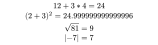
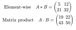
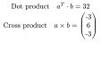
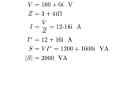
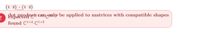

**Keep the equation. Get the answer.**

Kalt adds a calculator to Typst's math. Write an equation as you normally would and wrap the part you want calculated in `#comp(...)`. The answer appears right inside your document, ready for a thesis, report, lab notes, or other work.

## Calculate inside your equations

### Let Typst do the calculation

Use familiar math for sums, powers, roots, and more. Kalt fills in the result for you.

````typst
#import "@preview/kalt:0.1.1": comp

$ 12 + 3 * 4 = #comp($12 + 3 * 4$) $
$ (2 + 3)^2 = #comp($(2 + 3)^2$) $
$ sqrt(81) = #comp($sqrt(81)$) $
$ abs(-7) = #comp($abs(-7)$) $
````



### Add and multiply matrices

Add matrices cell by cell or calculate their matrix product.

````typst
#import "@preview/kalt:0.1.1": comp

#let a = $mat(1, 2; 3, 4)$
#let b = $mat(5, 6; 7, 8)$

$ "Element-wise" quad A * B = #comp($#a * #b$) $
$ "Matrix product" quad A dot B = #comp($#a dot #b$) $
````



### Work with vectors

Calculate dot and cross products with familiar vector notation.

````typst
#import "@preview/kalt:0.1.1": comp

#let a = $vec(1, 2, 3)$
#let b = $vec(4, 5, 6)$

$ "Dot product" quad a^T dot b = #comp($#a^T dot #b$) $
$ "Cross product" quad a times b = #comp($#a times #b$) $
````



### Use complex numbers

Complex numbers work in the same way as ordinary numbers. This example calculates current and power from voltage and impedance.

````typst
#import "@preview/kalt:0.1.1": comp

#let voltage = $100 + 0i$
#let impedance = $3 + 4i$

$ V &= #voltage " V" \
  Z &= #impedance Ω \
  I &= V / Z = #comp($#voltage / #impedance$) " A" \
  I^* &= #comp($(#voltage / #impedance)^*$) " A" \
  S &= V I^* = #comp($#voltage * (#voltage / #impedance)^*$) " VA" \
  abs(S) &= #comp($abs(#voltage * (#voltage / #impedance)^*)$) " VA" $
````



## More things you can do

### Numbers and functions

Use Typst's familiar math notation for real and complex numbers:

| Group | Syntax |
| --- | --- |
| Arithmetic | `+`, `-`, `*`, `/`, implicit multiplication, `%` |
| Powers and products | `^`, `dot`, `times`, factorial `!` |
| Roots and combinations | `sqrt(x)`, `root(n, x)`, `binom(n, k)` |
| Logarithms | `ln(x)`, `log_a(x)` |
| Trigonometry | `sin`, `cos`, `tan`, `arcsin`, `arccos`, `arctan` |
| Hyperbolic | `sinh`, `cosh`, `tanh`, `arcsinh`, `arccosh`, `arctanh` |
| Other functions | `abs(x)`, `floor(x)`, `ceil(x)`, `re(x)`, `im(x)` |
| Comparisons | `=`, `≠`, `<`, `≤`, `>`, `≥` |
| Bitwise | `∧` AND, `∨` OR, `⊕` XOR, `~` NOT |

Comparisons evaluate to numeric indicators: false is `0` and true is `1`. Bitwise operations require integer values. Boolean NOT is written `¬`; `⊙` is the boolean matrix product.

### Matrices, vectors, and selecting parts

Create matrices with `mat(...)` and column vectors with `vec(...)`. Commas separate entries, and semicolons start new matrix rows. Matrix `+`, `-`, `*`, and `/` work cell by cell for compatible shapes. Use `dot` for matrix multiplication. Transpose is `^T`; complex conjugation is `^*`.

Matrix indices start at zero. In a slice, the stop index is not included, and negative indices count from the end.

| Expression | Selection |
| --- | --- |
| `M[1, 2]` | One entry at row 1, column 2 |
| `M[:, 0]` | First column |
| `M[2, :]` | Third row |
| `M[1:3, 1:3]` | A 2×2 interior block |
| `M[::2, ::2]` | Every second row and column |
| `M[::-1, ::-1]` | Reverse both axes |
| `M[[0, -1], :]` | First and last rows |

Slices support `start:stop:step`, omitted boundaries, negative steps, and explicit index lists. For vectors, `abs(v)` is the vector length; for square matrices, `abs(M)` is the determinant.

### Work with a whole matrix

Kalt also includes helpers for changing and checking many matrix cells at once:

| Function | Purpose |
| --- | --- |
| `map(fn, ..mats)` | Transform aligned cells and return a matrix. The callback receives each cell followed by its zero-based column `x` and row `y`. |
| `reduce(fn, initial, ..mats)` | Combine cells into one result. Use `comp(value)` when the callback needs a number from math-content cells. |
| `any(fn, ..mats)` | Return true when at least one aligned cell satisfies the test. |
| `all(fn, ..mats)` | Return true only when every aligned cell satisfies the test. |
| `tensor-variant(value)` | Return `"scalar"` or `"matrix"` for mathematical content. |
| `to-float-if-possible(value)` | Evaluate numeric math content to a float; otherwise return the original value. |

For example, convert a matrix of measurements to percentage deviations and check its values:

````typst
#import "@preview/kalt:0.1.1": all, any, comp, map, reduce

#let samples = $mat(12, 18; 24, 31)$
#let corrected = map((value, x, y) => (value - 20) * 100, samples)
#let total = reduce((sum, value) => sum + comp(value), 0, samples)
#let has-over-limit = any(value => comp(value) > 30, samples)
#let all-positive = all(value => comp(value) > 0, samples)
````

The helpers can work with more than one matrix or vector at a time. When an input has no cell at a given position, Kalt passes `none` to the calculation.

## When a calculation cannot be completed

Kalt does not silently guess when an expression cannot be calculated. Typst shows an error at the expression, together with a message that helps explain what went wrong.

For example, these two matrices do not fit together for this multiplication:

````typst
#import "@preview/kalt:0.1.1": comp

#comp($5 % 0$)
````

Here, the remainder is calculated using zero as the second number. That is not possible, so Kalt marks the expression in red and explains that the second number must not be zero.



## Documentation and source

- [Source code and issue tracker](https://github.com/Uhrendoktor/kalt)
- [Development examples](https://github.com/Uhrendoktor/kalt/tree/main/typst/docs/examples)
- [Typst package documentation guidelines](https://github.com/typst/packages/blob/main/docs/documentation.md)

Kalt is released under the [MIT License](LICENSE).
