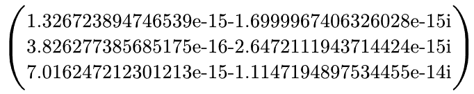
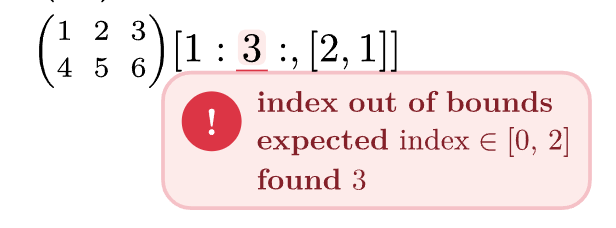

# Kalt

Kalt lets you calculate directly inside a Typst document. Wrap an expression in `comp(...)` to evaluate it. Real-number results can be reused in Typst code; complex numbers, vectors, and matrices keep their mathematical formatting.

Start with **Quick start** to add Kalt to a document. Use the examples throughout this guide as templates, and look up an operator or function when you need to know exactly how it behaves.

## Visual examples

Kalt evaluates full mathematical expressions and preserves readable mathematical output. The following examples show the input, evaluated result, and inline diagnostics.


```typst
#import "@preview/kalt:0.1.1": comp

$comp(frac(binom(2, 5) (1 + 3 i)^4.3 (2 - 3 i)^(2-5) 5!, sqrt((3+4i)(3-4i))) dot mat(
    1+i, 2, 0;
    0, 3-i, 0;
    0, 5, 7+i;
) dot vec(1, 2, 3))$
```






## Quick start

Import `comp` from the package:

```typst
#import "@preview/kalt:0.1.1": comp

$comp(sqrt((3 + 4i) (3 - 4i)))$ // 5
$comp(e^(i pi))$                // -1
$comp(mat(1, 2; 3, 4) dot mat(5, 6; 7, 8))$
```

`comp(body)` evaluates the supplied Typst math content.

- A real scalar result is returned as a Typst `float`, so it can be assigned to a Typst variable or used in code.
- A complex scalar is returned as math content.
- A matrix or vector is returned as math content.
- A matrix with shape `1 × 1` is unwrapped to its single scalar. If that scalar is real, `comp` returns a Typst float; otherwise it returns complex scalar content.
- Invalid expressions and incompatible shapes are represented as inline Typst error content rather than silently producing an incorrect numeric result.

```typst
#let x = comp($sin(pi / 2)$) // 1.0, a Typst float
#let z = comp($2 + 3i$)      // complex math content
#let one = comp($mat(1)$)    // 1.0, not a 1 × 1 matrix
```

## Value and shape model

Kalt evaluates scalars as complex numbers, so real and complex values can appear in the same expression. A matrix is a two-dimensional array of complex-valued entries. A vector is represented as a column matrix.

Most element-wise operations follow these rules:

| Left operand | Right operand | Behavior |
| --- | --- | --- |
| Scalar | Scalar | Produce a scalar |
| Scalar | Matrix/vector | Apply the scalar to every cell |
| Matrix/vector | Scalar | Apply the scalar to every cell |
| Matrix/vector | Matrix/vector of the same shape | Apply the operation to matching cells |
| Matrices with incompatible shapes | — | Return an error |

A scalar can be applied to every cell of a matrix. For an element-by-element operation, two matrices must have the same shape. `dot` is different: for matrix multiplication, the number of columns in the left matrix must equal the number of rows in the right matrix.

## Arithmetic operators

### Element-wise arithmetic

| Operator | Meaning | Notes |
| --- | --- | --- |
| `+` | Addition | Element-wise for matrices |
| `-` | Subtraction | Element-wise for matrices |
| `*` | Multiplication | Element-wise; a scalar applies to every matrix cell |
| `/` | Division | Element-wise; scalar/matrix combinations are supported |
| `%`, `mod` | Modulo | Element-wise; zero divisor is an error |
| `^` | Exponentiation | See matrix exponentiation rules below |
| `!` | Factorial | Uses the gamma function, so non-integer and complex inputs are supported |

Example:

```typst
$comp(mat(1, 2; 3, 4) * mat(5, 6; 7, 8))$ // mat(5, 12; 21, 32)
$comp(2 * mat(1, 2; 3, 4))$              // mat(2, 4; 6, 8)
$comp(mat(7, -7) % 4)$                   // mat(3, 1)
```

Kalt defines complex modulo following the convention

```text
a mod b = a - b Floor[a / b]
```

where the floor is applied separately to the real and imaginary parts of the complex quotient. For real operands, the result follows the divisor's sign. A zero divisor is an error.

### Exponentiation

- Scalar `^ ` scalar: complex exponentiation.
- Scalar raised to a matrix: element-wise exponentiation of each matrix entry.
- Matrix raised to a scalar: matrix power; the matrix must be square and the exponent must be a non-negative real integer.
- Matrix raised to a matrix: element-wise exponentiation; both matrices must have the same shape.

For inverse matrix power, use a supported expression for the inverse separately; negative exponents are not currently accepted by the matrix-power operation.

### Implicit multiplication

Consecutive atoms can imply multiplication. For scalar factors this behaves like ordinary multiplication; in Kalt's matrix expressions, the evaluator uses its dot-product operation for consecutive parsed atoms. Prefer explicit `dot` or `*` when the intended matrix semantics matter.

## Comparisons and logical operations

Kalt intentionally represents logical results numerically rather than introducing a distinct Boolean type. False is represented by `0`; true is represented by `1`. This means comparison results can be used directly in arithmetic and in matrices.

### Comparisons

| Operator | Meaning | Result |
| --- | --- | --- |
| `<` | Less than | `0` or `1` |
| `>` | Greater than | `0` or `1` |
| `<=`, `≤` | Less than or equal | `0` or `1` |
| `>=`, `≥` | Greater than or equal | `0` or `1` |
| `=` | Exact equality | `0` or `1` |
| `≠` | Exact inequality | `0` or `1` |

Ordered comparisons require real-valued operands. A complex value with a nonzero imaginary part has no ordering in Kalt and produces a comparison error. Equality and inequality support complex values and compare the evaluated real and imaginary components exactly; they do not apply an implicit tolerance. For matrices, `<`, `>`, `<=`, and `>=` compare corresponding entries element by element; they do not test positive definiteness or Loewner order. Positive-definite ordering is a separate matrix-wide relation (defined for Hermitian matrices) and should have an explicit dedicated API rather than silently changing the meaning of these operators.

```typst
$comp(3 > 2)$                     // 1
$comp(3 <= 3)$                    // 1
$comp((1 + 2i) = (1 + 2i))$       // 1
$comp((1 + 2i) ≠ (1 - 2i))$       // 1
$comp(mat(1, 4; 5, 2) < mat(2, 3; 5, 8))$ // mat(1, 0; 0, 1)
```

Comparison chains such as `1 < 2 < 3` are rejected rather than interpreted ambiguously. Write the equivalent logical expression explicitly: `(1 < 2) ∧ (2 < 3)`.

### Numeric Boolean literals

`op("true")` and `op("false")` provide readable aliases for `1` and `0` inside math expressions. They are numeric indicators, not a separate Boolean type.

```typst
$comp(op("true"))$             // 1
$comp(op("false"))$            // 0
$comp(2 ^ op("true"))$         // 2
$comp(op("true") + op("true"))$ // 2
```

### Integer AND, OR, XOR, and NOT

Kalt represents Boolean values numerically: false is `0` and true is `1`. The symbols `∧`, `∨`, and `⊕` perform bitwise AND, OR, and XOR on real integers. On inputs limited to `0` and `1`, AND and OR give the familiar logical results. These operators also work on other integers, including negative values.

The NOT symbol `¬` keeps the established Boolean behavior for `0` and `1` (`0 → 1`, `1 → 0`). For any other integer, it performs two's-complement bitwise NOT, so `¬2 = -3` and `¬(-6) = 5`. Fractional or complex operands are rejected.

Kalt stores numeric values as floating-point numbers, so integer bitwise operands must lie within the safe-integer range `-9007199254740991` through `9007199254740991`. Values outside that range are rejected because floating-point numbers cannot distinguish every integer there. The operators apply element-wise to matrices, and scalar-to-matrix operations are supported when matrix shapes are compatible.

```typst
$comp(6 ∧ 3)$ // 2
$comp(6 ∨ 3)$ // 7
$comp(6 ⊕ 3)$ // 5
$comp(¬2)$    // -3
$comp(¬0)$    // 1
$comp(mat(6, 2) ∧ mat(3, 1))$ // mat(2, 0)
```

### Ordinary dot versus Boolean product

Kalt's existing `dot` operator performs ordinary arithmetic dot/matrix multiplication. The `⊙` operator is a Boolean matrix product: two entries count as a match only when both are `1`, and an output entry is `1` when at least one match exists.

For vectors:

```typst
$comp(mat(1, 1) dot mat(1; 1))$ // 2: ordinary arithmetic dot product
$comp(mat(1, 1) ⊙ mat(1; 1))$  // 1: at least one pair is simultaneously 1
```

For matrices, each output entry of `A ⊙ B` is `1` exactly when there exists an inner index `k` for which both `A[i, k]` and `B[k, j]` equal `1`. The matrices must have compatible inner dimensions, and every entry must be real and exactly `0` or `1`. Invalid entries or shapes produce an error.

This is not multiplication modulo 2: Boolean-semiring multiplication combines matches with OR, whereas GF(2) multiplication counts their parity. The `⊙` symbol is reserved here for the Boolean product; do not assume it means element-wise multiplication in Kalt.

## Complex numbers

The imaginary unit is written `i`. Complex numbers are supported in arithmetic, functions, matrices, and other expressions.

| Expression | Meaning |
| --- | --- |
| `conjugate(x)` | Complex conjugate |
| `Re(x)` | Real part |
| `Im(x)` | Imaginary part |

```typst
$comp(e^(i pi))$                  // -1
$comp(conjugate(2 + 3i))$         // 2 - 3i
$comp(Re(2 + 3i) + i Im(2 + 3i))$ // 2 + 3i
```

## Matrices and vectors

### Construction

Use Typst's math matrix/vector notation:

```typst
$comp(mat(1, 2; 3, 4))$ // 2 × 2 matrix
$comp(vec(1, 2, 3))$    // 3 × 1 column vector
```

Matrices are stored as two-dimensional arrays. A vector is a column matrix; to create a row matrix, use a one-row `mat(...)`.

### Matrix and vector operations

| Operation | Meaning | Requirements |
| --- | --- | --- |
| `dot` | Ordinary dot product / matrix multiplication | Inner dimensions must match; scalar-matrix dot scales element-wise |
| `⊙` | Boolean-semiring product | Inputs must contain only real 0/1; inner dimensions must match |
| `×` | Cross product | Both vectors must have shape `3 × 1` |
| `T`, `⊤` | Transpose | Operand must be a matrix/vector |

```typst
$comp(mat(1, 2; 3, 4) dot mat(5, 6; 7, 8))$
$comp(vec(1, 0, 0) × vec(0, 1, 0))$ // vec(0, 0, 1)
$comp(mat(1, 2; 3, 4)^T)$
```

### Absolute value / determinant / vector norm

`abs(x)` and vertical bars `|x|` are supported.

- Scalar: complex magnitude.
- Column vector: Euclidean norm.
- Square matrix: determinant.
- Non-square matrix that is not a column vector: error.

```typst
$comp(abs(3 + 4i))$        // 5
$comp(abs(vec(3, 4)))$    // 5
$comp(abs(mat(1, 2; 3, 4)))$ // -2
```

### Indexing and slicing

Indices are zero-based. A matrix can be indexed by row and column selectors, including individual indices, lists of indices, and ranges. A slice can specify `start:stop:step`; negative steps reverse or traverse backward.

```typst
$comp(mat(1, 2; 4, 5)[0, 1])$             // 2
$comp(mat(1, 2; 4, 5)[:, 0])$             // vec(1, 4)
$comp(mat(1, 2, 3; 4, 5, 6)[1:2:, [2, 1]])$ // selected row/columns
$comp(mat(1, 2, 3; 4, 5, 6)[::-1, ::-1])$ // reverse rows and columns
```

A slice uses the backend's Typst-aware range/index parser; invalid indices or incompatible selectors are reported inline.

## Mathematical functions

All listed functions support complex scalars. Except where noted, unary functions are applied element-wise to matrices and vectors.

### Powers, roots, combinatorics, and rounding

| Function / notation | Meaning | Notes |
| --- | --- | --- |
| `sqrt(x)` | Principal square root | Element-wise for matrices |
| `root(n, x)` | `n`th root of `x` | Root index must not be zero |
| `binom(n, k)` | Binomial coefficient | Element-wise; matrix arguments must have the same shape |
| `ceil(x)` | Ceiling | Applied separately to real/imaginary parts |
| `floor(x)` | Floor | Applied separately to real/imaginary parts |
| `⌊x⌉` or `⌈x⌋` | Round | Rounds real/imaginary parts independently |
| `sign(x)` | Sign operation | Element-wise for matrices |
| `! ` | Factorial | Element-wise for matrices |

The bracket-style rounding operators use the mixed floor/ceiling symbols as shown, rather than ordinary parentheses.

### Trigonometric and hyperbolic functions

| Function | Ways to write its inverse |
| --- | --- |
| `sin(x)` | `sin^(-1)(x)`, `arcsin(x)`, `op("asin")(x)` |
| `cos(x)` | `cos^(-1)(x)`, `arccos(x)`, `op("acos")(x)` |
| `tan(x)` | `tan^(-1)(x)`, `arctan(x)`, `op("atan")(x)` |
| `sinh(x)` | `sinh^(-1)(x)`, `arcsinh(x)`, `op("asinh")(x)` |
| `cosh(x)` | `cosh^(-1)(x)`, `arccosh(x)`, `op("acosh")(x)` |
| `tanh(x)` | `tanh^(-1)(x)`, `arctanh(x)`, `op("atanh")(x)` |

Yes—each hyperbolic function has an inverse. For example, `arcsinh(x)` and `op("asinh")(x)` both mean inverse hyperbolic sine. The superscript `(-1)` is another spelling of the inverse function; it does **not** mean the reciprocal `1 / sinh(x)`. Inverse trigonometric and hyperbolic functions return principal complex values.

```typst
$comp(arcsinh(sinh(1)))$       // 1
$comp(op("asinh")(sinh(1)))$ // 1
$comp(sinh^(-1)(sinh(1)))$     // 1
```

### Logarithms

| Function | Meaning |
| --- | --- |
| `ln(x)` | Natural logarithm |
| `log_a(x)` | Logarithm of `x` with base `a` |

Example:

```typst
$comp(ln(2^4))$  // ln(16)
$comp(log_2(16))$ // 4
```

## Number formats

Decimal numbers and scientific notation are accepted. Binary and hexadecimal literals can also be written inside a parsed math expression.

```typst
$comp("2.1e3" + 1)$  // 2101
$comp("0b010" * 2)$  // 4
$comp("0XFF"i / 2)$  // 127.5i
```

The string-wrapped examples preserve the literal spelling for Kalt's number parser. Complex values can be written with `i`.

## Typst helper functions

In addition to `comp`, the Typst library exports helpers for applying callbacks to matrices and combining values by coordinate. Import them as needed:

```typst
#import "@preview/kalt:0.1.1": comp, map, reduce, any, all
```

### `map(fn, ..mats)`

Applies a callback to corresponding cells in one or more matrices/vectors and returns a matrix of callback results. The callback receives each input cell first, then the zero-based column coordinate `x`, then row coordinate `y`.

- Numeric cells are passed to the callback as Typst floats when possible.
- Non-numeric cells are preserved as Typst content.
- When input shapes differ, missing cells are passed as `none`.
- Callback output is preserved, including arbitrary Typst content such as highlights.

```typst
#let m = $mat(2, 2; 2, 6)$
$map((a, x, y) => $#a + #x + #y$, m)$
```

### `reduce(fn, initial, ..mats)`

Visits aligned coordinates across the supplied matrices/vectors and folds callback results into an accumulator. The callback receives the accumulator first, then the current cell from each input. Missing cells in differently shaped inputs are passed as `none`.

### `any(fn, ..mats)` and `all(fn, ..mats)`

These helpers apply a predicate at each aligned coordinate. The predicate must return a Typst Boolean.

- `any` returns true if the predicate is true at least once.
- `all` returns true only if the predicate is true at every visited coordinate.

```typst
#let m = $mat(1, 2; 3, 4)$
#any(value => comp(value) > 3, m) // true
#all(value => comp(value) > 0, m) // true
#all(value => comp(value) > 1, m) // false
```

## Error behavior

Kalt reports invalid operations, non-real ordered comparisons, invalid integer bitwise operands, and incompatible matrix shapes as inline Typst errors. Typical causes include:

- an ordered comparison involving a complex number with a nonzero imaginary part;
- applying the bitwise operators to fractional, complex, or out-of-safe-range values;
- applying `⊙` to values other than real `0`/`1`;
- element-wise matrix operations whose non-scalar operands have different shapes;
- dot products with incompatible inner dimensions;
- trying to transpose a scalar or exponentiate a non-square matrix by a matrix power.

## Operator precedence

From tightest to loosest:

1. Grouping, Typst math attachments (such as powers/roots), and function-like atoms.
2. Factorial and indexing.
3. Unary sign and bitwise NOT (`¬`).
4. Dot product, Boolean product, element-wise multiplication, modulo, and cross product.
5. Addition and subtraction.
6. Comparisons.
7. Bitwise AND (`∧`).
8. Bitwise XOR (`⊕`).
9. Bitwise OR (`∨`).

A comparison chain is non-associative in Kalt. Use explicit parentheses and logical operators to combine comparisons.

## Limitations to know

- Boolean indicators are numeric: false is `0`, true is `1`. There is no separate Boolean value type inside Kalt.
- `∧`, `∨`, and `⊕` are bitwise integer AND, OR, and XOR. `¬` preserves Boolean NOT for 0/1 and complements other real safe integers.
- `⊙` is for Boolean matrix products whose entries are real `0` or `1`; it is not element-wise multiplication or multiplication modulo 2.
- Kalt can apply a scalar to a matrix, but it does not automatically resize two differently shaped matrices to make them fit.
- Bitwise operators are defined only for real integers in Kalt's floating-point safe-integer range.


