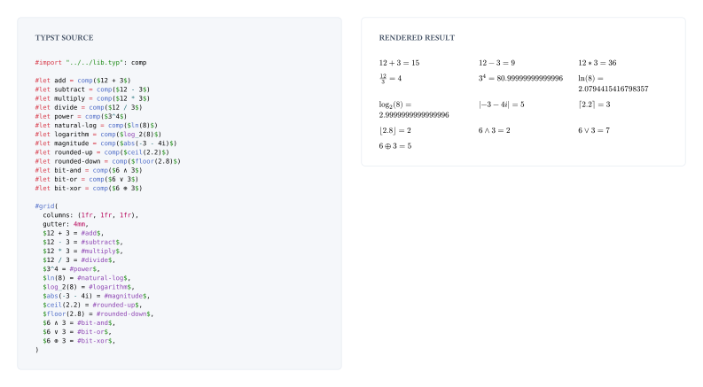
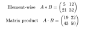
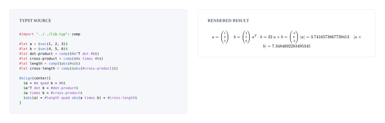
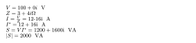

**Keep the equation. Get the answer.**

Kalt evaluates native Typst math content in place. Write an expression once and use its computed value in the same equation or elsewhere in your document. It works with real and complex numbers, vectors, matrices, nested operators, and slices—without translating your math into a second expression language.

## Evaluate your first expression

Import `comp` and wrap the math content you want evaluated. A real result becomes a Typst number; complex, vector, and matrix results remain native mathematical content.

### Nested expressions and operator precedence

Combine powers, functions, grouping, arithmetic, comparisons, and bitwise operators in one expression.


````typst
#import "@preview/kalt:0.1.1": comp
$ (2 + 3i)^2 = #comp($(2 + 3i)^2$) $

$ (2 + 3 * (4^2 - 5)) / 4 = #calc.round(comp($(2 + 3 * (4^2 - 5)) / 4$), digits: 2) $

$ log_2(2^3 + 8) - ln(e^2) = #calc.round(comp($log_2(2^3 + 8) - ln(e^2)$), digits: 2) $

$ ((12 + 3 * 4) > (2^3 + 2)) ∧ 6 ⊕ 3 ∨ 2 = #comp($((12 + 3 * 4) > (2^3 + 2)) ∧ 6 ⊕ 3 ∨ 2$) $
````



### Matrix algebra

Compatible matrices support element-wise arithmetic. Use `dot` when you want matrix multiplication.


````typst
#import "@preview/kalt:0.1.1": comp
#let a = $mat(1, 2; 3, 4)$
#let b = $mat(5, 6; 7, 8)$

$ "Element-wise" quad A * B = #comp($#a * #b$) $

$ "Matrix product" quad A dot B = #comp($#a dot #b$) $
````



### Vector products

Vectors are column vectors. Transpose the left operand for a dot product; use `times` for the three-dimensional cross product.


````typst
#import "@preview/kalt:0.1.1": comp
#let a = $vec(1, 2, 3)$
#let b = $vec(4, 5, 6)$

$ "Dot product" quad a^T dot b = #comp($#a^T dot #b$) $

$ "Cross product" quad a times b = #comp($#a times #b$) $
````



### Complex arithmetic

Complex values work throughout expressions, including division, powers, conjugation, and magnitude.


````typst
#import "@preview/kalt:0.1.1": comp
#let voltage = $100 + 0i$
#let impedance = $3 + 4i$
#let current = comp($#voltage / #impedance$)
#let conjugate = comp($#current^*$)
#let power = comp($#voltage * #conjugate$)

$ V = #voltage " V" $

$ Z = #impedance Ω $

$ I = V / Z = #current " A" $

$ I^* = #conjugate " A" $

$ S = V I^* = #power " VA" $

$ abs(S) = #comp($abs(#power)$) " VA" $
````



## What Kalt evaluates

### Scalars and complex numbers

Use Typst's native math syntax for real and complex expressions. Kalt supports nested arithmetic, implicit multiplication, powers, factorials, roots, binomial coefficients, comparisons, and bitwise operations.

| Group | Syntax |
| --- | --- |
| Arithmetic | `+`, `-`, `*`, `/`, implicit multiplication, `%` |
| Powers and products | `^`, `dot`, `times`, factorial `!` |
| Roots and combinations | `sqrt(x)`, `root(n, x)`, `binom(n, k)` |
| Logarithms | `ln(x)`, `log_a(x)` |
| Trigonometry | `sin`, `cos`, `tan`, `arcsin`, `arccos`, `arctan` |
| Hyperbolic | `sinh`, `cosh`, `tanh`, `arcsinh`, `arccosh`, `arctanh` |
| Other functions | `abs(x)`, `floor(x)`, `ceil(x)`, `re(x)`, `im(x)` |
| Comparisons | `=`, `≠`, `<`, `≤`, `>`, `≥` |
| Bitwise | `∧` AND, `∨` OR, `⊕` XOR, `~` NOT |

Comparisons evaluate to numeric indicators: false is `0` and true is `1`. Bitwise operations require integer values. Boolean NOT is written `¬`; `⊙` is the boolean matrix product.

### Matrices, vectors, and indexing

Create matrices with `mat(...)` and column vectors with `vec(...)`. Commas separate entries, and semicolons start new matrix rows. Matrix `+`, `-`, `*`, and `/` are element-wise for compatible shapes. Use `dot` for matrix multiplication. Transpose is `^T`; complex conjugation is `^*`.

Matrix indices are zero-based. The stop index in a slice is excluded, and negative indices count from the end.

| Expression | Selection |
| --- | --- |
| `M[1, 2]` | One entry at row 1, column 2 |
| `M[:, 0]` | First column |
| `M[2, :]` | Third row |
| `M[1:3, 1:3]` | A 2×2 interior block |
| `M[::2, ::2]` | Every second row and column |
| `M[::-1, ::-1]` | Reverse both axes |
| `M[[0, -1], :]` | First and last rows |

Slices support `start:stop:step`, omitted boundaries, negative steps, and explicit index lists. For vectors, `abs(v)` is the vector length; for square matrices, `abs(M)` is the determinant.

### Transform and inspect matrix data

Kalt includes helpers for cell-wise transformations and aggregation:

| Function | Purpose |
| --- | --- |
| `map(fn, ..mats)` | Transform aligned cells and return a matrix. The callback receives each cell followed by its zero-based column `x` and row `y`. |
| `reduce(fn, initial, ..mats)` | Fold aligned cells into an accumulator. Use `comp(value)` when the callback needs a number from math-content cells. |
| `any(fn, ..mats)` | Return true when at least one aligned cell satisfies the predicate. |
| `all(fn, ..mats)` | Return true only when every aligned cell satisfies the predicate. |
| `tensor-variant(value)` | Return `"scalar"` or `"matrix"` for mathematical content. |
| `to-float-if-possible(value)` | Evaluate numeric math content to a float; otherwise return the original value. |

For example, convert a matrix of measurements to percentage deviations and inspect the cells:

````typst
#import "@preview/kalt:0.1.1": all, any, comp, map, reduce
#let samples = $mat(12, 18; 24, 31)$
#let corrected = map((value, x, y) => (value - 20) * 100, samples)
#let total = reduce((sum, value) => sum + comp(value), 0, samples)
#let has-over-limit = any(value => comp(value) > 30, samples)
#let all-positive = all(value => comp(value) > 0, samples)
````

The aggregation helpers accept multiple matrices or vectors. Inputs are aligned by coordinate; a missing cell from a smaller input is passed as `none`.

## Errors and compatibility

Kalt reports evaluation and shape errors as formatted Typst errors, so an invalid operation is visible at the expression that caused it. Matrix and vector operations check compatible dimensions instead of silently discarding mismatched data.

## Documentation and source

- [Source code and issue tracker](https://github.com/Uhrendoktor/kalt)
- [Development examples](https://github.com/Uhrendoktor/kalt/tree/main/typst/docs/examples)
- [Typst package documentation guidelines](https://github.com/typst/packages/blob/main/docs/documentation.md)

Kalt is released under the [MIT License](LICENSE).
